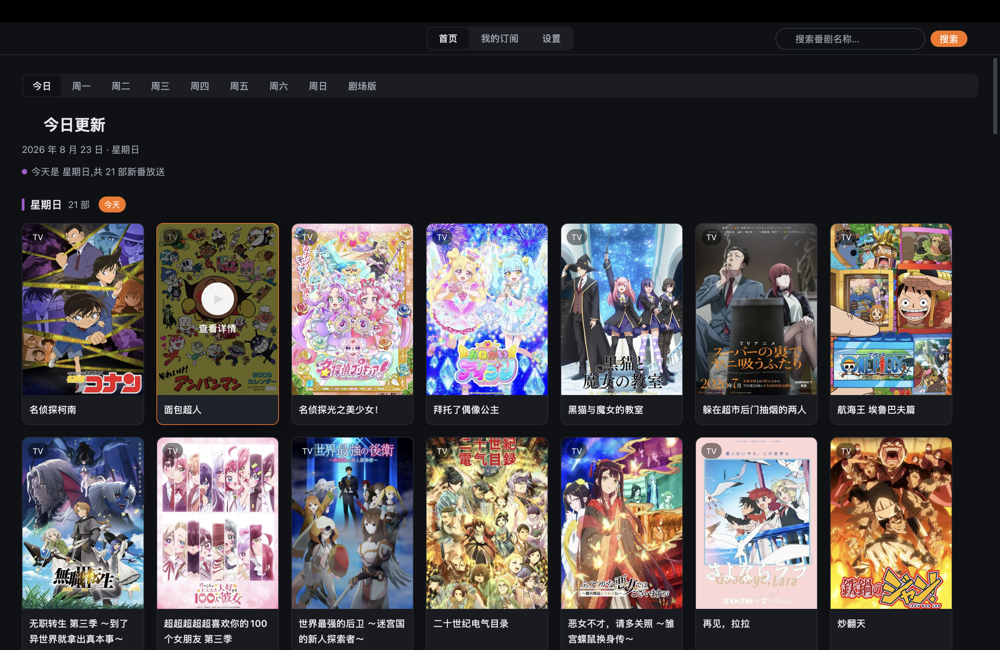

# MikanPlus

MikanPlus 是一款桌面追番应用，数据来源于[蜜柑计划](https://mikanani.me)。你可以浏览番剧更新、按字幕组订阅，并在应用内管理剧集下载。

## 功能

- 浏览今日更新、每周番剧和剧场版
- 搜索番剧与剧集
- 按字幕组订阅番剧
- 自动获取订阅内容
- 使用磁力链接下载剧集
- 查看下载进度、速度和任务状态
- 下载完成后可用系统播放器打开单个视频,多视频任务可查看合集并逐个打开
- 取消订阅前确认是否移除对应的下载目录和文件,默认保留下载内容
- 支持深色和浅色主题

## 安装

### Linux

默认使用用户级 AppImage 安装，不需要 root：

```bash
curl -fsSL https://github.com/TY0909/MikanPlus/releases/latest/download/MikanPlus-linux-install.sh | bash
```

安装完成后可用命令启动和卸载：

```bash
mikanplus
mikanplus --uninstall
```

默认卸载会保留配置、缓存和下载文件。完全删除配置和缓存：

```bash
mikanplus --uninstall --purge
```

需要所有用户使用时，可以选择系统级安装：

```bash
curl -fsSL https://github.com/TY0909/MikanPlus/releases/latest/download/MikanPlus-linux-install.sh \
  | sudo bash -s -- --system
```

Linux 发布版本面向 x86_64、glibc ≥ 2.35（Ubuntu 22.04+ / Debian 12+）。也可以从 Releases 下载 `.deb` 或便携版 tar.gz。

### Windows / macOS

从 [Releases](https://github.com/TY0909/MikanPlus/releases) 下载安装包：Windows 使用 `.exe` 安装器或 `.zip` 便携版，macOS 使用 `.dmg`。

## 使用说明

1. 在首页浏览或搜索感兴趣的番剧。
2. 进入番剧详情页，选择字幕组进行订阅或下载。
3. 在订阅页面管理已订阅的番剧。
4. 在设置页面调整主题、下载目录和退订时是否默认移除下载内容。

## 截图



## 免责声明

本项目基于个人兴趣开发，仅用于学习和交流。请在下载内容后 24 小时内删除，并遵守当地法律法规，请勿用于违法用途。

## License

Apache-2.0
