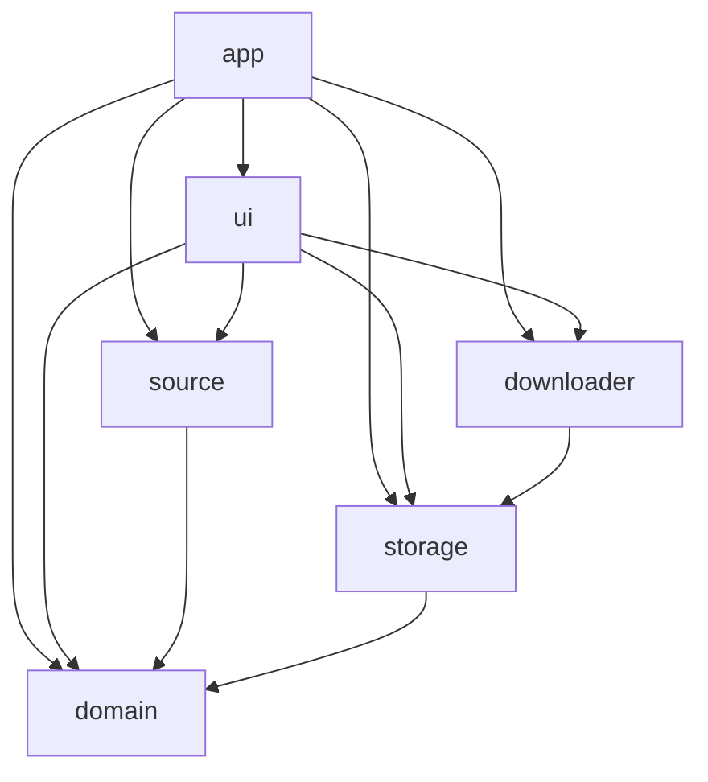

# Architecture

MikanPlus follows the GPUI Kit application architecture: dependencies point downward, the application shell owns orchestration, and reusable capabilities do not depend on presentation.



## Crate responsibilities

### `domain`

Owns serialized domain records and navigation values. It has no GPUI, network, filesystem, or download-engine dependency.

### `storage`

Owns local state, the on-disk cover-image cache, API-data cache, migrations, application directories, filename normalization, and platform operations for opening files and URLs. Home, detail, and episode API responses are persisted as re-fetchable TTL-bound cache entries; search results remain memory-only because they are temporary query state.

### `source`

Owns the Mikan data adapters, request throttling and backoff, and URL normalization. It exposes three sources and maps each to `domain` records:

- The public JSON API (`api`): home listing (`GET /api/v1/bangumi?year=&season=`), bangumi metadata plus subtitle-group summaries (`GET /api/v1/bangumi/{id}`), keyword search (`GET /api/v1/search?q=&page=&pageSize=`), and paginated subgroup episodes (`GET /api/v1/bangumi/{id}/episodes?page=&pageSize=&subtitleGroupId=`). The home query is derived from the local calendar and falls back to the previous season only when the current season has no released content. Query-sensitive requests ask upstream caches to revalidate.
- The RSS endpoint (`rss`): retained for compatibility with existing subscription URLs, but it is no longer used to populate detail-page episodes.
- The HTML parser (`parser`): retained for compatibility and tests while old page-format support is phased out; application search no longer depends on it.

### `downloader`

Owns the librqbit session, command serialization, torrent metadata, task snapshots, connection status, cancellation, and cleanup. Commands are processed in send order while snapshot generation remains independent. The session listens on both IPv4 and IPv6 (a fixed default port with an ephemeral fallback) so hosts behind NAT/CGNAT can still accept incoming connections over a public IPv6 address; an optional SOCKS5 proxy can be configured through `MIKAN_SOCKS_PROXY`.

### `ui`

Owns application presentation, theme configuration, page-local retained state, and UI Actions. It accesses GPUI only through `gpui-kit` and places stateful component entities in the view that owns their lifecycle.

### `app`

Is the composition root. It initializes GPUI Kit, creates the window `Root`, binds Actions, installs native menus, owns application-wide state, and coordinates storage, source, downloader, and UI capabilities.

## Dependency rules

- GPUI ecosystem APIs are imported only through `gpui-kit`.
- `domain` must remain independent of GPUI and infrastructure.
- Lower-level crates must not depend on `app`.
- Cross-crate APIs expose domain intent rather than implementation details where practical.
- Background work must not retain a closed GPUI entity indefinitely.
- Repeated UI elements use stable domain-derived identities.
- Theme definitions may contain concrete colors; application rendering should use semantic theme values.

## Validation

The workspace quality gate is:

```bash
cargo fmt --all --check
cargo clippy --workspace --all-targets --all-features -- --deny warnings
cargo test --workspace --all-features
```
